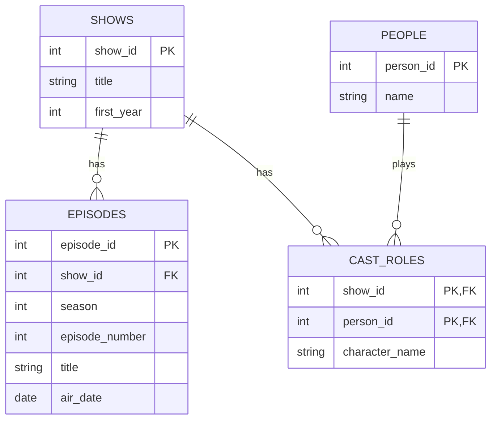

# TV Show ERD

## How to read it

- A show has zero or more episodes. An episode belongs to exactly one show.
- A show has many actors and an actor is in many shows, so `cast_roles` sits in the middle. Its two keys together are its primary key.