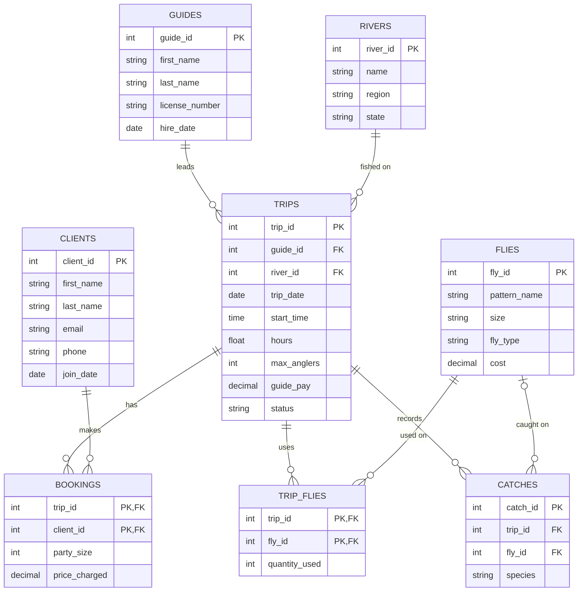

 # 1. The Scenario

VicFly is a small fly-fishing guide service that runs trips in New England and the Pacific Northwest. It runs guided trips on rivers in several states and keeps its records in a notebook and a phone contacts list. The owner wants to know which states and flies earn and catch the most, which clients come back, and whether any trip is overbooked.

**What it keeps today**
- Clients: first name, last name, email, phone and join date.
- Guides: first name, last name, license number and hire date.
- Rivers: name, region and state.
- Trips: one guide on one river on one date, with a start time, length in hours, the most anglers it takes, the guide's pay and a status: booked, completed or cancelled.
- Bookings: a client's place on a trip, with the party size and the price charged that day. A client books many trips, and a trip has many clients.
- Flies: pattern name, size, type (dry, nymph or streamer) and cost.
- Flies used on a trip: how many of each fly the guide used on that trip.
- Catches: the species of each fish on a trip, and the fly it took, which is sometimes not recorded.

**The rules it works by**
- A trip has exactly one guide and one river.
- A price and a guide's pay are more than zero, a party size is at least one, and a fish's length is more than zero.
- A trip's status is booked, completed or cancelled, and nothing else.
- A client has at most one booking on a trip.
- The party sizes booked on a trip never add up to more than its maximum number of anglers. A CHECK cannot hold this, so it is checked with a query.

**Business questions**
1. Revenue for each state, largest first.
2. Fish caught per trip for each river, counting trips that caught nothing.
3. Which fly caught the most fish.
4. The busiest month by number of trips.
5. The clients who have not booked in the last 12 months, or never.
6. Each guide's number of trips, revenue and pay, and the margin.
7. For each fly, the quantity used against the fish caught on it.
8. (checks a rule) The trips where booked party sizes add up to more than the maximum number of anglers.

   # 2. The ERD

   # 3. What One Row Means
# 3. What One Row Means

- **clients:** One row of clients is one person who has signed up to fish with VicFly.
- **guides:** One row of guides is one licensed guide who works for VicFly.
- **rivers:** One row of rivers is one river where VicFly runs trips, with its region and state.
- **trips:** One row of trips is one guided trip led by one guide on one river on one date.
- **bookings:** One row of bookings is one client's place on one trip, with the party size and the price charged.
- **flies:** One row of flies is one kind of fly, a pattern in one size, with its type and cost.
- **trip_flies:** One row of trip_flies is how many of one kind of fly were used on one trip.
- **catches:** One row of catches is one fish caught on a trip, with its species and, if known, the fly it took.

   # 4. Design Choices
1. **Keys.** The business already identifies clients by email and guides by license number. I chose an invented number as the primary key for both (`client_id` and `guide_id`), and I kept the email and license number as UNIQUE columns. I did this because emails can change, and a primary key should not change, since other tables point to it.

2. **Optional relationships.** The fly on a catch is optional, because the scenario says the fly a fish took is sometimes not recorded, so `catches.fly_id` can be empty. A client can exist without any booking, and a trip can exist without any catches, so those links are optional on the "many" side too.

3. **Rules the tables cannot hold.** A trip's booked party sizes can never add up to more than its maximum anglers. A CHECK only looks at one row, and this rule needs the total of many rows in `bookings`, so no constraint can hold it. Question 8 checks it with a query that adds up the party sizes for each trip and compares them with `max_anglers`.

4. **One thing I changed.** The first draft of the design had a fish length on each catch. I took it out of `catches` because none of my questions needed it, and I removed the rule about length that went with it.